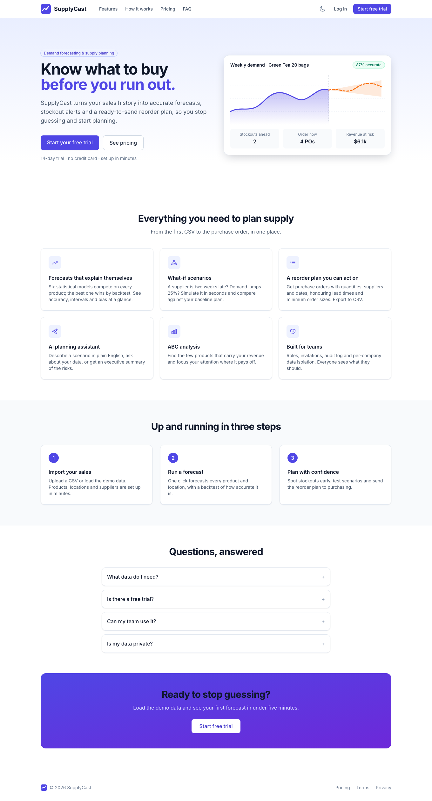
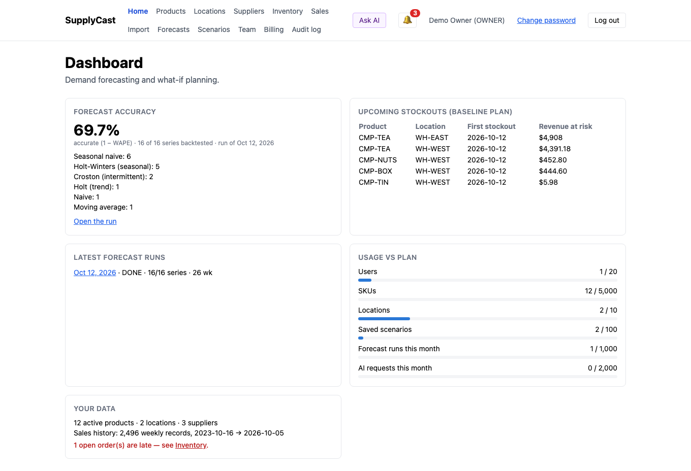
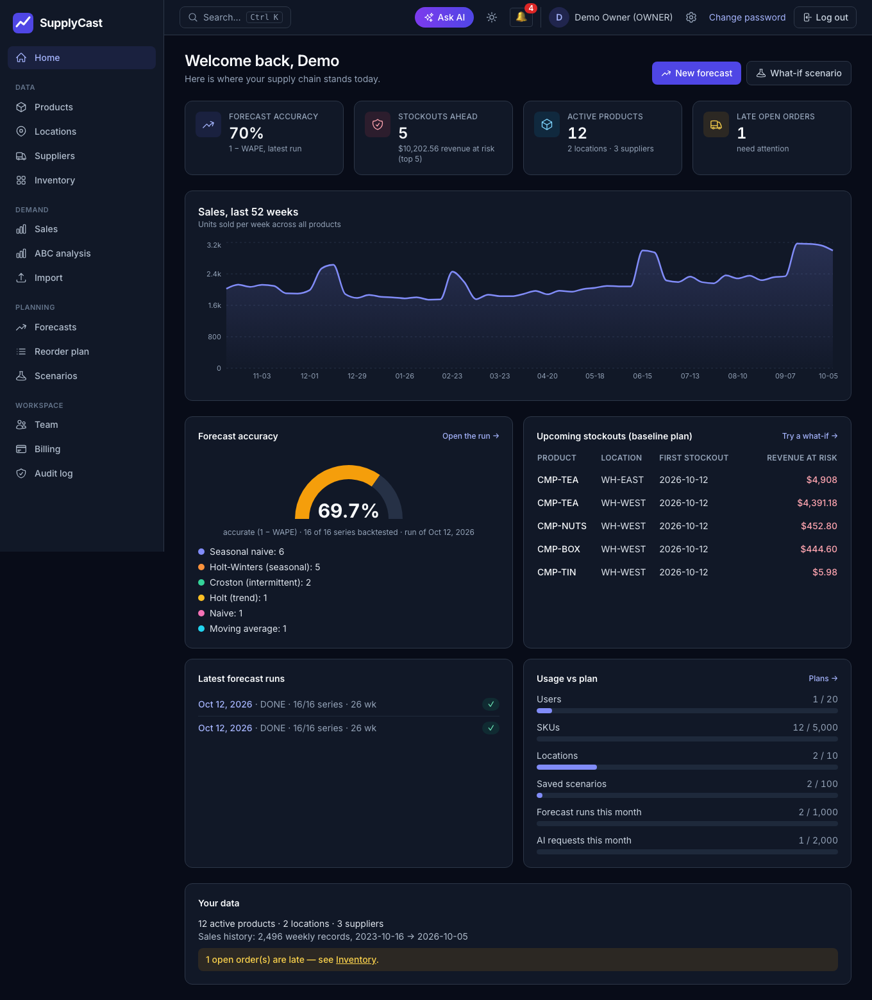
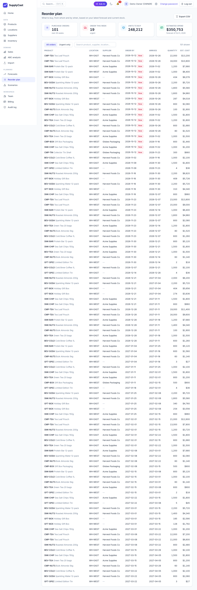
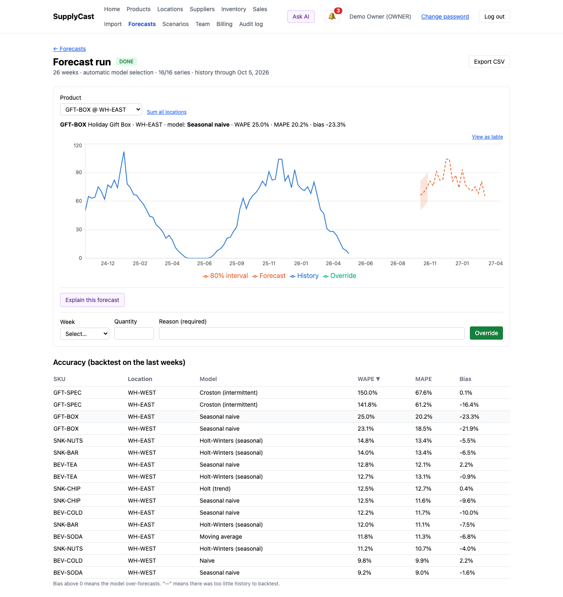
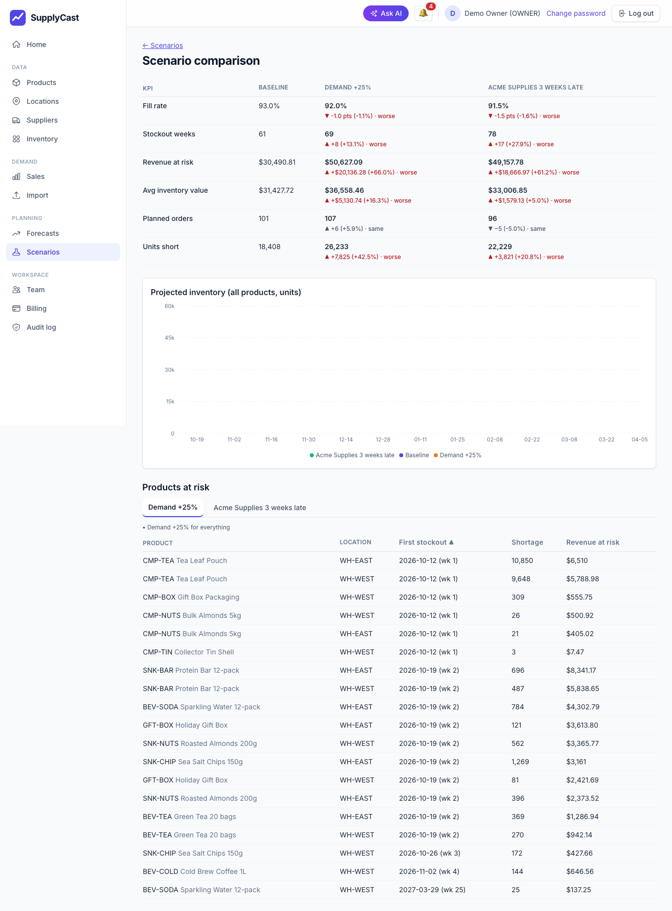
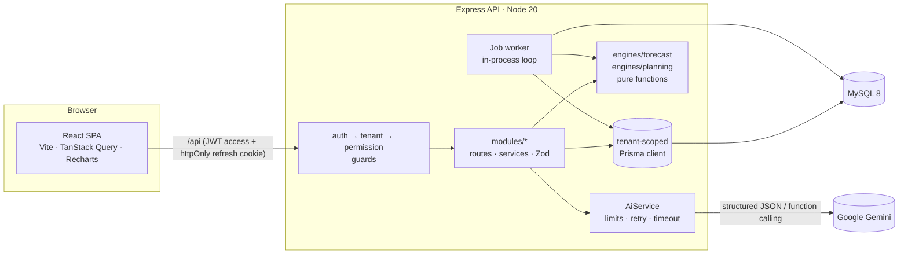
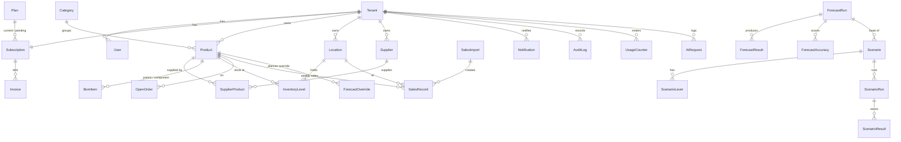

# SupplyCast

Multi-tenant SaaS for **supply-chain demand forecasting and what-if planning**. Companies upload their sales history; SupplyCast forecasts demand per product and location, projects inventory against supplier lead times, lets planners run what-if scenarios ("supplier X is 3 weeks late", "demand for category Y rises 20%") and compare the outcomes — and uses Google Gemini to explain forecasts, turn plain-English questions into scenarios and summarise risks.

**Stack:** MySQL 8 · Express · React 18 · Node 20, TypeScript everywhere (MERN with MySQL instead of MongoDB). Gemini is the only external service.

|                                                 |                                                   |
| ----------------------------------------------- | ------------------------------------------------- |
| Landing page                                    |           |
| Dashboard (light)                               |       |
| Dashboard (dark mode)                           |       |
| Reorder plan                                    |      |
| Forecast with prediction interval and overrides |         |
| Scenario comparison                             |  |

More screenshots: [sales explorer](docs/screenshots/sales-explorer.png) · [scenario](docs/screenshots/scenario.png) · [billing](docs/screenshots/billing.png) · [products](docs/screenshots/products.png) · [pricing](docs/screenshots/pricing.png) · [ABC analysis](docs/screenshots/abc-analysis.png) · [forecast, dark](docs/screenshots/forecast-dark.png) · [settings](docs/screenshots/settings-dark.png) · [login](docs/screenshots/login.png). They are generated from the seeded demo tenant by `npm run screenshots`.

---

## Quick start (local)

```bash
cp .env.example .env            # edit the secrets; change DEV_DB_PORT/TEST_DB_PORT if 3306/3307 are taken
docker compose up -d            # dev MySQL (:3306) and test MySQL (:3307)
npm install
npm run db:migrate              # apply Prisma migrations to the dev database
npm run db:seed                 # create the Super Admin from SUPER_ADMIN_EMAIL / SUPER_ADMIN_PASSWORD
npm run db:seed:demo            # optional: demo company (demo@supplycast.local / DemoPass12345) with 3 years of data
npm run dev                     # API on :4000, web on :5173
```

Open <http://localhost:5173>. Sign up for a new company (you get a 14-day Starter trial) and click **Load demo data**, or log in as the demo owner. The Super Admin console is at `/admin`.

Set `AI_PROVIDER=fake` in `.env` to use a deterministic offline AI (used by the end-to-end tests). With `AI_PROVIDER=gemini` (default) put a real `GEMINI_API_KEY` in `.env`; without one the AI buttons answer "AI features are not configured".

### Scripts

| Command                              | What it does                                                               |
| ------------------------------------ | -------------------------------------------------------------------------- |
| `npm run dev`                        | API + web in watch mode                                                    |
| `npm run lint` / `npm run typecheck` | ESLint + Prettier check / `tsc` in every workspace                         |
| `npm test`                           | API (Jest + real MySQL test DB) and web (Vitest) tests with coverage gates |
| `npm run e2e`                        | Playwright end-to-end tests (starts API and web if not running)            |
| `npm run build`                      | Production build (API bundled with esbuild, web with Vite)                 |
| `npm run screenshots`                | Regenerate `docs/screenshots` from the demo tenant                         |
| `npm run loadtest -w apps/api`       | Forecast load test (1,000 SKUs × 3 locations × 3 years)                    |

First time only: `npx playwright install chromium`.

---

## What it does

| Area                 | Highlights                                                                                                                                                                                                                                                                                           |
| -------------------- | ---------------------------------------------------------------------------------------------------------------------------------------------------------------------------------------------------------------------------------------------------------------------------------------------------- |
| **Accounts & roles** | Signup creates a tenant + Owner. Roles: Super Admin, Owner, Admin, Planner, Viewer, enforced by one permission map shared by API and UI. Invite links and password-reset links are shown once and copied manually (no email service).                                                                |
| **Tenant isolation** | Every tenant-owned query goes through a tenant-scoped Prisma client; a test fails if a model with `tenantId` is not registered. Cross-tenant access answers **404**, never 403 or data.                                                                                                              |
| **Plans & billing**  | Plans and limits are database rows (Free / Starter / Pro / Enterprise). **Payments are simulated: choosing a plan applies it instantly and shows "Payment successful"** — no gateway, no pending state. Invoices are issued already paid. Downgrades are blocked while usage exceeds the new limits. |
| **Limits**           | Users, SKUs, locations, saved scenarios (live counts) and forecast runs, AI requests (per calendar month) — enforced atomically with a tenant row lock, `402 PLAN_LIMIT_REACHED`, notifications at 80% / 100%.                                                                                       |
| **Master data**      | Categories (2 levels), products, locations, suppliers + supplier-product links, multi-level bill of materials with cycle detection, inventory levels, open orders.                                                                                                                                   |
| **Demand data**      | Sales CSV import (preview with per-row errors, weekly aggregation, background commit, re-import replaces a week), demo-data generator, sales explorer.                                                                                                                                               |
| **Forecasting**      | 7 models, backtesting and automatic model selection per series, background runs, accuracy table, prediction intervals, planner overrides, CSV export.                                                                                                                                                |
| **What-if planning** | Baseline supply plan (safety stock, lead times, MOQ, capacity, BOM explosion), 6 lever types, scenario runs, side-by-side comparison.                                                                                                                                                                |
| **AI (Gemini)**      | Forecast explanation, plain-English scenario builder (proposes levers, saves nothing until confirmed), scenario risk summary, tool-calling assistant over a fixed allow-list of read-only functions.                                                                                                 |
| **Insights**         | **Reorder plan** (planned purchase orders with supplier, order/arrival dates, quantity and spend, urgent filter, CSV export) and **ABC analysis** (Pareto chart + A/B/C classes by revenue).                                                                                                         |
| **Product polish**   | Public landing page, split-screen auth pages, **light / dark / system theme** (persisted, no flash), Ctrl/⌘+K command palette, settings page, 404 + legal pages, responsive sidebar layout.                                                                                                          |
| **Email**            | Invites, password-reset links and a welcome message are emailed (SMTP via `EMAIL_PROVIDER=smtp`; the default `log` driver records without sending). Mail failures never block the action — the copy-link flow always remains.                                                                        |
| **Operations**       | Super Admin console (tenants, plans, MRR, trial conversion, AI usage, failed jobs, suspend/reactivate, read-only impersonation), audit log, in-app notifications, background job runner with retries.                                                                                                |

---

## Architecture



- **Monorepo** (npm workspaces): `apps/api`, `apps/web`, `apps/e2e`, `packages/shared` (Zod schemas, types and the permission map used by both sides).
- **Engines are pure** (`apps/api/src/engines`): no database access, fully unit- and property-tested. Services load data, call an engine and store the result.
- **Background work** runs in an in-process loop over a `Job` table (no Redis): claim → run → retry with backoff → `FAILED` with the error message. Recurring jobs (daily billing maintenance) re-enqueue themselves.
- **Auth:** bcrypt passwords, 15-minute JWT access token kept in memory by the SPA, rotating refresh token in an httpOnly SameSite=Strict cookie (re-use of a rotated token revokes all of a user's sessions), 5 failed logins lock the account for 15 minutes.

### Data model



All tenant-owned tables carry an indexed `tenantId`; money is stored as integer cents, quantities as decimals. Every schema change is a Prisma migration under `apps/api/prisma/migrations`.

---

## Forecasting methods (`engines/forecast`)

Weekly series, oldest first; weeks without a record count as zero demand. All forecasts are clamped at zero; the **80% prediction interval** is `forecast ± 1.2816 × σ × growth(step)` where σ is the standard deviation of the in-sample one-step residuals.

| Model                              | Idea                                                                        |
| ---------------------------------- | --------------------------------------------------------------------------- |
| Naive                              | Last value                                                                  |
| Seasonal naive                     | Same week last year (needs ≥ 1 season, else falls back to naive)            |
| Moving average                     | Mean of the last _w_ weeks (default 4)                                      |
| Simple exponential smoothing       | Level only; α chosen by grid search on squared error                        |
| Holt                               | Level + linear trend; (α, β) grid-searched                                  |
| Holt-Winters (additive, season 52) | Level + trend + yearly seasonality; needs ≥ 2 seasons else degrades to Holt |
| Croston                            | Intermittent demand: size and interval between demands smoothed separately  |

**Backtesting and selection** (`engines/forecast/backtest.ts`): the last 12 weeks (shrunk for short series) are held out, every eligible model is fitted on the rest and scored with **WAPE** (Σ|f−a| / Σ|a|), MAPE and bias; the lowest WAPE wins (ties go to the simpler model). Series shorter than 2 seasons skip Holt-Winters and seasonal naive; series with more than 50% zero weeks use Croston. The chosen model is refitted on the full history.

## Planning and scenarios (`engines/planning`)

Per product/location and week, in pure functions:

```
onHand[t] = onHand[t-1] + receipts[t] − demand[t] + shortage[t]      (shortage ≥ 0, onHand ≥ 0)
```

- **Demand** = forecast with planner overrides; finished-good demand is exploded through the (multi-level) BOM into component demand at the same location.
- **Receipts** = open orders in their expected week (late orders land in week 0) + planned orders.
- **Safety stock** = `z(service level) × σ(weekly demand) × √(lead weeks)`, at least the configured inventory safety stock; σ comes from the last 26 weeks of (exploded) sales.
- **Planned orders**: at the start of each week the engine projects the position at the moment an order placed now would arrive; if it is below safety stock it orders up to `safety + cover weeks of demand` (default 4), rounded up to the supplier's MOQ, capped by weekly capacity, arriving after the lead time. A capped quantity is re-ordered in later weeks (carried forward).
- **KPIs**: stockout weeks, fill rate, average inventory value, revenue at risk, number of planned orders; plus a ranked at-risk list.

**Levers** (validated by their own Zod schemas): demand change (% for a product / category / location / everything over a date range), supplier delay (extra days), lead-time change, capacity cap, target service level, price change (% with elasticity). A scenario run always computes the baseline (no levers) too so comparisons are fair.

## AI (`apps/api/src/ai`, `apps/api/src/modules/ai`)

All calls go through one `AiService` over an `AiClient` interface (Gemini in production, `FakeAiClient` in tests): plan-limit check (402) before any call, structured JSON validated with Zod and **retried once**, 30-second timeout, usage charged only for successful calls, an `AiRequest` row per call, friendly errors, and **no prompts or keys in logs**. Prompts are versioned template functions in `ai/prompts`. Only aggregated, non-personal data is sent (recent weekly numbers, summary statistics, names of products/suppliers/categories).

- **Explain forecast** – cached per run + product + location, so repeated clicks cost nothing.
- **Scenario builder** – the model returns _names_; the server resolves them against the tenant's own lists (unknown names are shown as unresolved, never guessed), validates each lever with the same Zod schemas as manual levers, and returns a proposal. Nothing is saved until the planner confirms.
- **Risk summary** – executive summary + 3–5 actions from KPIs and the at-risk list.
- **Assistant** – the model never writes SQL. It may only call six read-only, tenant-scoped functions (`getTopProductsByRevenue`, `getWorstAccuracy`, `getAtRiskProducts`, `getSalesTrend`, `getLowStockProducts`, `getLateOpenOrders`); unknown names and invalid arguments are rejected. One question costs one request of quota.

---

## Testing

| Type            | Tool                                      | Where                                                                                               |
| --------------- | ----------------------------------------- | --------------------------------------------------------------------------------------------------- |
| Unit + property | Jest + fast-check                         | `apps/api/src/engines/**` (forecast models, planning engine, levers, BOM), CSV parsing, MRR, limits |
| Integration     | Jest + Supertest + **real MySQL test DB** | `apps/api/src/modules/**/*.test.ts`, `apps/api/src/security.test.ts`                                |
| Component       | Vitest + React Testing Library            | `apps/web/tests`                                                                                    |
| End-to-end      | Playwright (real Chromium)                | `apps/e2e/tests` — one journey per phase, AI via the deterministic fake                             |

Every endpoint is tested for the happy path per allowed role, **401**, **403** for each role that may not call it, **tenant isolation (404)**, **400** for bad input and **402** at plan limits (shared helpers `expectRoleAccess` / `expectTenantIsolation`). `security.test.ts` introspects every registered route and fails if one has no auth, role or tenant guard unless it is on an explicit public allow-list, and checks the max page size (100) on every list endpoint. Gemini is **never** called from tests (a test fails if a test file imports the real client). The test database is truncated between files; coverage gates: API ≥ 80%, web ≥ 70%.

## Performance

Load test (`npm run loadtest -w apps/api`, MacBook Air, local MySQL 8 in Docker, Node 24): **1,000 SKUs × 3 locations × 156 weeks = 468,000 sales rows** (3,000 series).

| Step                                                                                         | Result                                                          |
| -------------------------------------------------------------------------------------------- | --------------------------------------------------------------- |
| Seeding the sales history                                                                    | 41 s                                                            |
| Forecast run, `AUTO` model selection, 26-week horizon                                        | **13.8 s** — 3,000 / 3,000 series, 0 failed, 78,000 result rows |
| Peak memory of the process                                                                   | 278 MB (series are processed in chunks of 40 products)          |
| Scenario run (baseline + scenario, 3,000 nodes × 26 weeks × 2 variants, 156,000 result rows) | **10.1 s**                                                      |

The forecast engines are pure functions (about 4 ms per series including the backtest of every eligible model), so wall-clock time is dominated by loading history and writing results.

---

## Deployment

### Docker (any host)

```bash
cp .env.example .env     # set JWT_ACCESS_SECRET, JWT_REFRESH_SECRET, SUPER_ADMIN_*, GEMINI_API_KEY
docker compose -f docker-compose.prod.yml up -d --build
# web on http://localhost:8080 (nginx serves the SPA and proxies /api to the API)
```

`Dockerfile.api` bundles the API with esbuild; its entrypoint runs `prisma migrate deploy`, seeds the default plans and the Super Admin, then starts the server. `Dockerfile.web` builds the SPA and serves it with nginx, which proxies `/api/` to the API and rewrites the refresh-cookie path (`/auth` → `/api/auth`). Put TLS in front (the refresh cookie is `Secure` in production) and set `APP_URL` / `API_URL` to the public URLs.

### Railway (API + web + managed MySQL)

1. Create a project and add the **MySQL** plugin; copy its connection URL.
2. Add a service from this repo with **Dockerfile path `Dockerfile.api`**. Variables: `DATABASE_URL` (MySQL URL), `DATABASE_URL_TEST` (any placeholder), `JWT_ACCESS_SECRET`, `JWT_REFRESH_SECRET` (long random strings), `APP_URL` (the web URL), `API_URL`, `GEMINI_API_KEY`, `GEMINI_MODEL`, `AI_PROVIDER=gemini`, `SIMULATED_PAYMENTS=true`, `SUPER_ADMIN_EMAIL`, `SUPER_ADMIN_PASSWORD`, `NODE_ENV=production`.
3. Add a second service with **`Dockerfile.web`** and `API_UPSTREAM` = the API service's private URL (for example `http://api.railway.internal:4000`).
4. Open the web service's public URL, sign up, and load the demo data. Optionally run `node dist/seedDemo.js` in the API service shell to create the demo tenant.

(Render works the same way for the two Docker services, but needs an external MySQL because Render's managed database is Postgres.) A public demo URL needs your own hosting account, so none is bundled here.

### Environment variables

See `.env.example`. `AUTH_RATE_LIMIT_MAX` (default 20 per 15 min per IP) can be raised for local end-to-end runs. Email uses `EMAIL_PROVIDER` (`log`|`smtp`), `EMAIL_FROM` and `SMTP_*`. The API refuses to start if a required variable is missing (validated with Zod in `apps/api/src/config`).

---

## Project layout

```
apps/
  api/        Express API, Prisma schema + migrations, engines, job worker, AI layer
  web/        React SPA (features/*, components/, routes/)
  e2e/        Playwright journeys (+ screenshot generator)
packages/shared/   Zod schemas, types and the role/permission map shared by API and UI
deploy/            nginx template and the API container entrypoint
```
